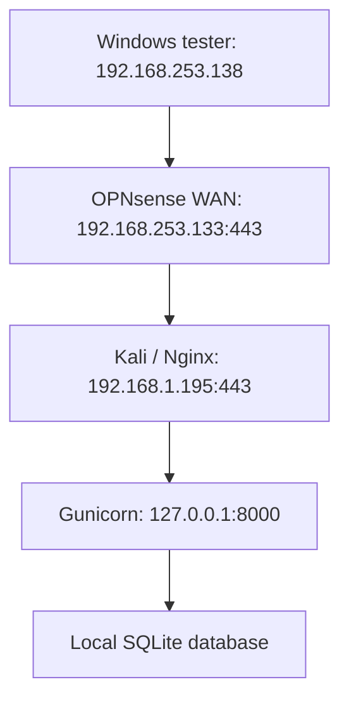

# מבנה המעבדה

OPNsense LAN: `192.168.1.1/24`. ה־WAN מחובר לרשת NAT של VMware וה־LAN לרשת המעבדה הפנימית. המקור המורשה בחוק הוא `192.168.253.138/32`, והיעד לאחר NAT הוא `192.168.1.195:443`. כתובות אלה הן דוגמת המעבדה ולא הוראות להחלה על רשת אחרת.

שרת היישום מאזין על Loopback. SQLite הוא קובץ מקומי ואין לו פורט רשת. בדיקת חסימה צריכה לעבור דרך ה־Firewall, ללא חיבור חלופי ישיר לשרת.
